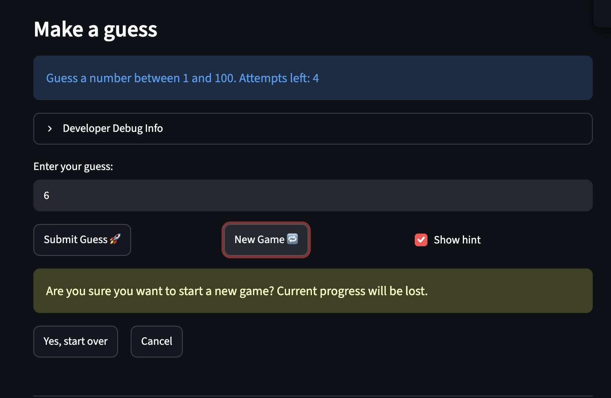
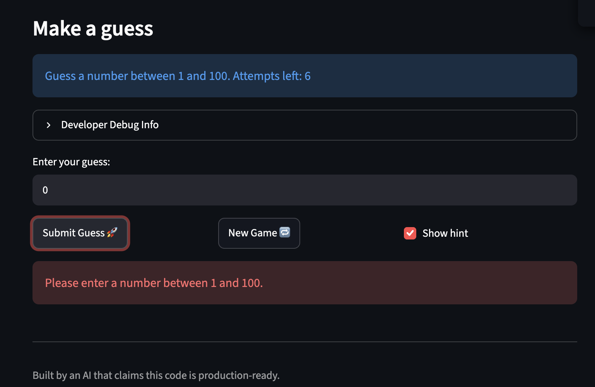

# 🎮 Game Glitch Investigator: The Impossible Guesser

## 🚨 The Situation

You asked an AI to build a simple "Number Guessing Game" using Streamlit.
It wrote the code, ran away, and now the game is unplayable. 

- You can't win.
- The hints lie to you.
- The secret number seems to have commitment issues.

## 🛠️ Setup

1. Install dependencies: `pip install -r requirements.txt`
2. Run the app: `python -m streamlit run app.py`

## 🕵️‍♂️ Your Mission

1. **Play the game.** Open the "Developer Debug Info" tab in the app to see the secret number. Try to win.
2. **Find the State Bug.** Why does the secret number change every time you click "Submit"? Ask ChatGPT: *"How do I keep a variable from resetting in Streamlit when I click a button?"*
3. **Fix the Logic.** The hints ("Higher/Lower") are wrong. Fix them.
4. **Refactor & Test.**
   - Move the logic into `logic_utils.py`.
   - Run `pytest` in your terminal.
   - Keep fixing until all tests pass!

## 📝 Document Your Experience

### Game purpose

Game Glitch Investigator is a number-guessing game built with Streamlit. The app picks a secret number within a range set, the player has a limited number of attempts to find it, and each guess gets a "Go HIGHER / Go LOWER" hint and updates a score. 

### Bugs found

| # | Bug | What happened |
|---|-----|---------------|
| 1 | Backwards hints | A too-high guess said "Go HIGHER!" and a too-low guess said "Go LOWER!". |
| 2 | Secret becomes a string on even attempts | The comparison broke on every second attempt, so hints were wrong. |
| 3 | "Attempts left" label is one guess behind | The label was drawn before the submit handler incremented the attempt counter, so it showed the count from before the latest guess. |
| 4 | Out-of-range numbers accepted | Guesses like 0 and -2 were accepted and got a hint instead of an error. |
| 5 | "New Game" button did nothing | Clicking it did not reset the secret, score, attempts or history. |

### Fixes applied

- **Attempts label (bug 3):** moved the calculation into `attempts_left()` in `logic_utils.py`. `app.py` imports it and draws the label into a placeholder (`st.empty()`), then redraws it after the guess is processed so it shows the updated count.
- **Out-of-range guesses (bug 4):** moved `parse_guess` into `logic_utils.py` (only the import remains in `app.py`) and added `low`/`high` parameters. Guesses outside the difficulty's range are rejected with "Please enter a number between {low} and {high}." and no longer count as a valid guess.
- **New Game (bug 5):** clicking "New Game" now asks "Are you sure?". Confirming calls `reset_game()` in `logic_utils.py`, which picks a new secret, resets attempts, score, status and history, clears the input box, and shows "New Game Started". Cancel dismisses the prompt without changing anything.
- **Wrong hints (bugs 1 and 2):** moved `check_guess` into `logic_utils.py` (only the import remains in `app.py`). The hints were swapped, so a too-high guess now says "Go LOWER!" and a too-low guess says "Go HIGHER!". It now returns just the outcome ("Win", "Too High" or "Too Low"), and a new `get_hint()` gives the message. I also removed the even-attempt `str(secret)` conversion that broke the comparison.

## 📸 Demo Walkthrough

1. Enter a number.
2. The app checks it is between 1 and 100.
3. Click "New Game".
4. The app asks "Are you sure?" and restarts when you confirm.
5. Enter another number.
6. The attempts label shows the correct number left.
7. Guess a number higher or lower than the secret.
8. The hint is correct: "Go LOWER!" if too high, "Go HIGHER!" if too low.

**Screenshots:**




## 🧪 Test Results

```text
tests/test_game_logic.py ........                                  [100%]

=============================== 8 passed in 0.01s ===============================
```

## 🚀 Stretch Features

- [ ] [If you choose to complete Challenge 4, describe the Enhanced UI changes here — a screenshot is optional]
